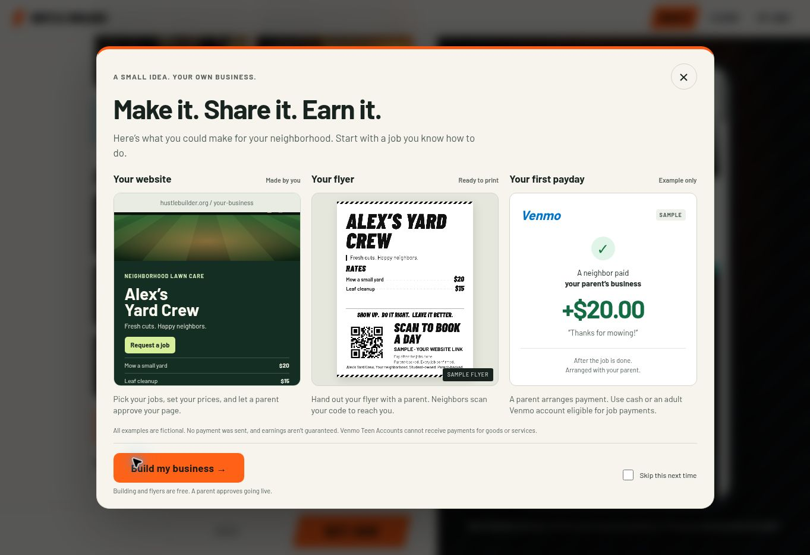
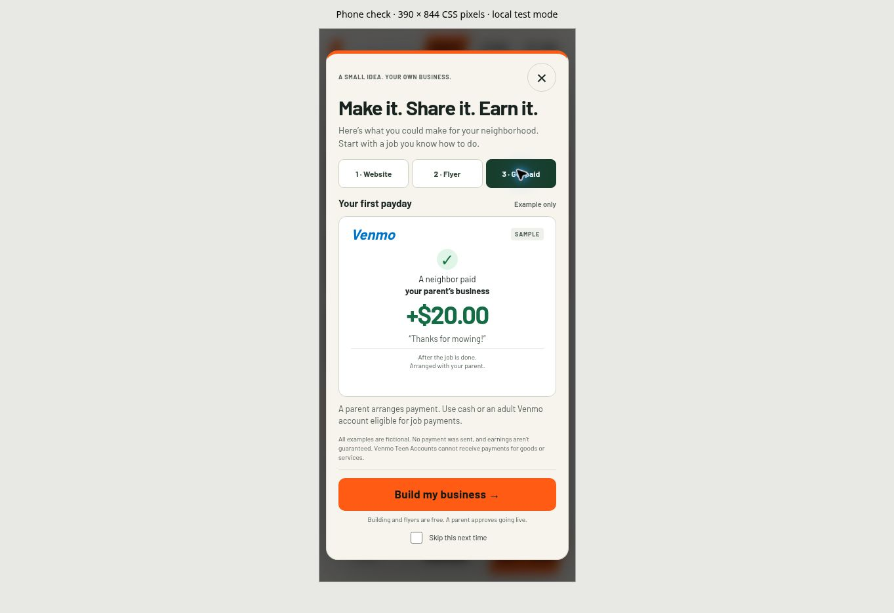
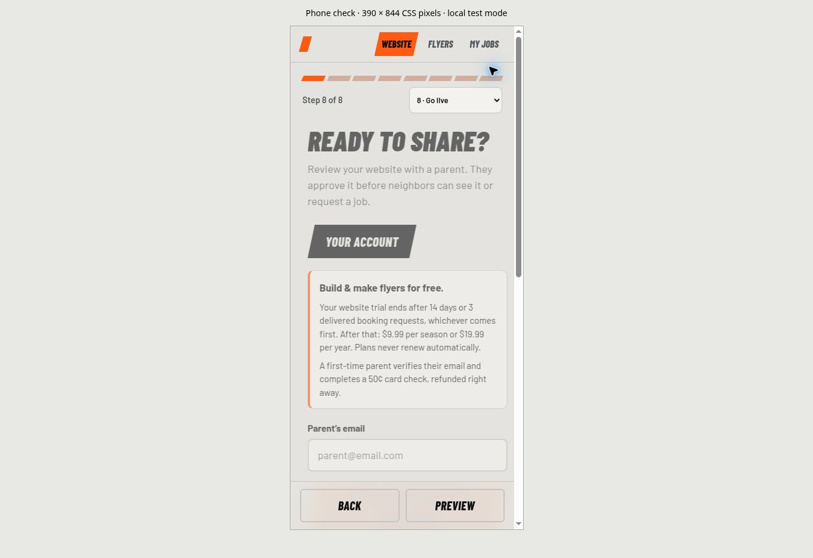

# Hustle Builder launch audit — November 12, 2026

This change makes the builder easier for a child to understand and adds the requested website → flyer → payment example. It is a review branch based on production commit `9bc6449`; it does not certify the business as ready to sell or merge itself into production.

## Changes

| Finding | Repair |
| --- | --- |
| Intro depended on an absent video and did not show the outcome. | Responsive example dialog with a fictional website, a flyer made by the real flyer renderer, and a clearly labeled $20 Venmo example. All three appear on desktop; phone users have three tabs. |
| Long first screen and obscure Build / Print / Boss names. | Website / Flyers / My jobs navigation, two-column work choices, optional pet advice, and grouped settings. |
| Children had to repeatedly step through everything. | Named step selector, contextual Next labels, and return to the last saved builder step. |
| Repeated pricing, style, publishing, and printer instructions competed with the main task. | Optional disclosures and one clear launch pricing summary. Parent email stays visible above the invitation button. |
| Getting paid seemed required before building. | Optional Parent & payment step, explicit public-email disclosure, adult-account Venmo guidance, and clear cash/payment-after-work wording. |
| Backup contact email promised alerts the server does not send. | Removed the unused email field from the UI and explained which parent actually gets booking emails. Existing saved data is retained. |
| Invitations implied the full draft was available on another device. | Invitation email and link explain reviewing together on the original device. An unrelated or empty local draft cannot be presented as the invited draft. No pre-consent draft upload was added. |
| SMS flyer depended on the public website phone toggle. | Validated parent phone independently for the flyer QR. The public website setting stays unchanged. |
| SMS flyer caption printed the number even with the flyer phone checkbox off. | Caption names the parent without printing the number; the existing explicit phone option controls visible phone printing. The UI explains that scanning an SMS QR reveals its number. |
| Every service could be disabled while the publish checklist still passed. | At least one offered, named service is required. Older service rows remain compatible. |
| Failed local saves appeared successful. | Visible save warning with recovery on the next successful write. |
| Booking requests appeared in the publishing step while the money log was elsewhere. | Booking inbox and existing job/earnings tools now share My jobs. |
| Selected calendar date said “Locked in” before parent confirmation. | “Selected,” with explicit confirmation instructions and accurate fallback/contact copy. |
| Old metadata and backup copy were misleading. | One manifest, improved description, updated offline/backup instructions, and clearer optional photos. |

Existing artwork, themes, names, poster layouts, calendar, billing model, and account architecture are retained.

## Verification

- `npm test`: **163 passed, 0 failed**. Includes account isolation, payments/refunds, booking behavior, storage, preserved artwork, and new intro, flyer privacy, save-failure, invitation, and service-validation regressions.
- `npm run test:stress`: **29 passed, 0 failed**. See [results](stress-results.json). External payment and email calls are mocked; these are not live transaction results.
- Syntax checks for the dev server and updated browser regression scripts; `git diff --check` clean.
- Manual browser inspection at desktop width and a genuine 390 × 844 CSS iframe viewport: all nine work types, name suggestions, rates, day selection, parent fields, flyer mode, Go live, example tabs, keyboard focus wrapping, Escape, and replay.
- Downloaded both a PNG and a one-page PDF flyer. Confirmed the QR option works with the website phone setting off.
- Browser-authenticated publishing/payment was not exercised in this session. Existing browser scripts were updated for the new controls but were not executed; their results are not included in the pass counts above.
- A locally seeded public page loaded and rendered the booking form. Its browser submission displayed a send error in the managed preview, including after setting the preview's public origin. The cause was not isolated; server-side booking tests and stress checks pass. **A successful booking on the HTTPS deployment is still a release check.**

## Before selling

1. Review and merge the PR through Steve's established workflow; check the resulting HTTPS deployment.
2. Complete a real-device parent sign-in → refunded 50¢ verification → publish → neighbor booking → parent confirmation smoke test. Confirm both email delivery and the refund in Stripe. No real email, charge, or refund was sent in this audit.
3. Complete the existing project privacy/terms and parental-consent review, including operator business contact details. This audit changes interface wording and does not provide legal approval. See `SETUP.md`'s existing launch guidance.
4. Pages already published are stored HTML. Builder-generated payment/contact wording changes reach those pages when the family republishes; the new builder experience applies after the deployment loads.

## Screenshots

## Payment wording reference

Official Venmo guidance reviewed for the example and parent step:

- [Teen account FAQ for parents and guardians](https://help.venmo.com/cs/articles/teen-account-faq-for-parents-guardians-vhel117)
- [Using Venmo for goods or services](https://help.venmo.com/cs/articles/can-i-use-venmo-to-buy-or-sell-merchandise-goods-or-services-vhel227)

The welcome payment is fictional. It does not contact Venmo, link to a real recipient, or promise earnings.
